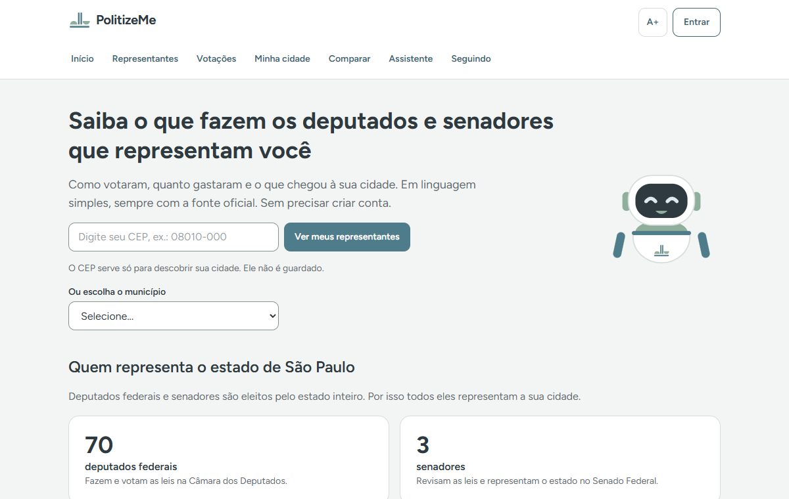
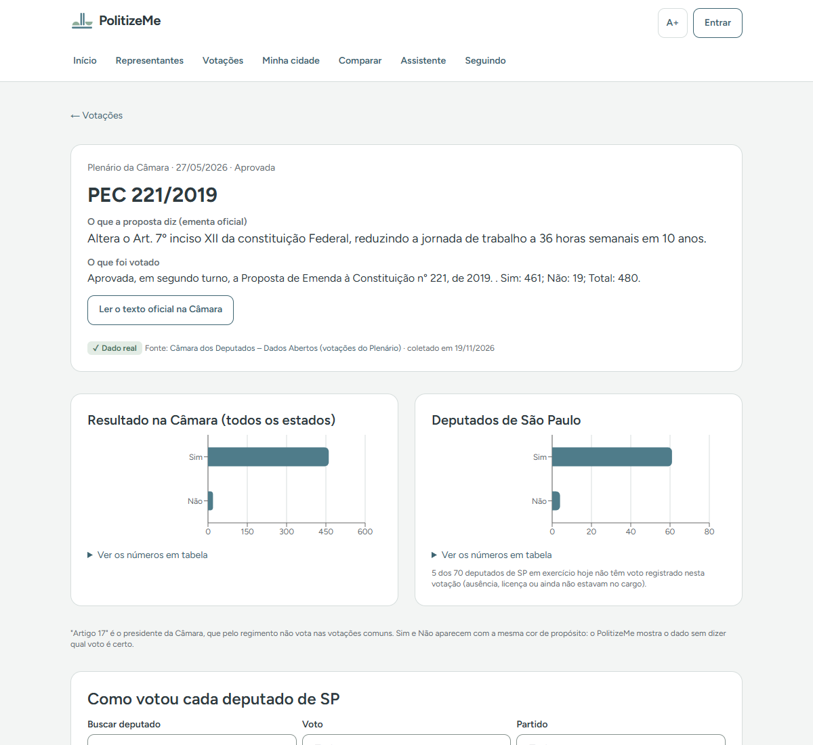
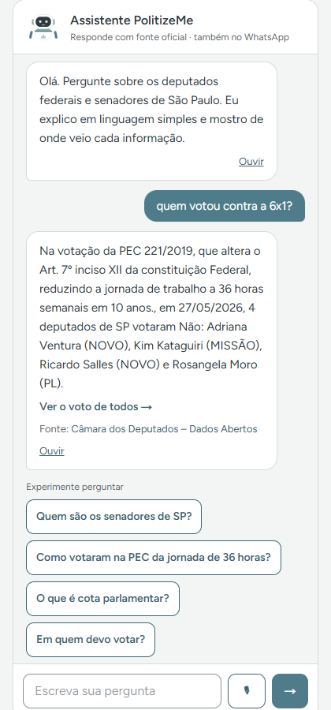
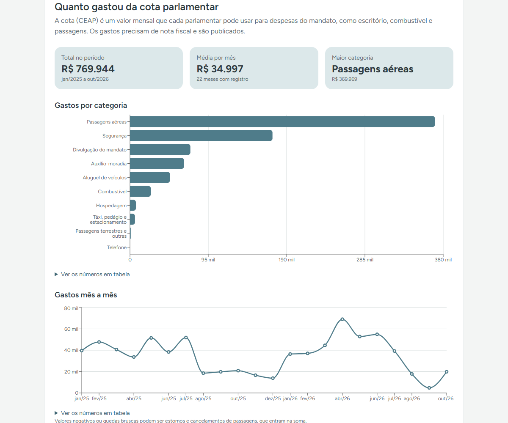
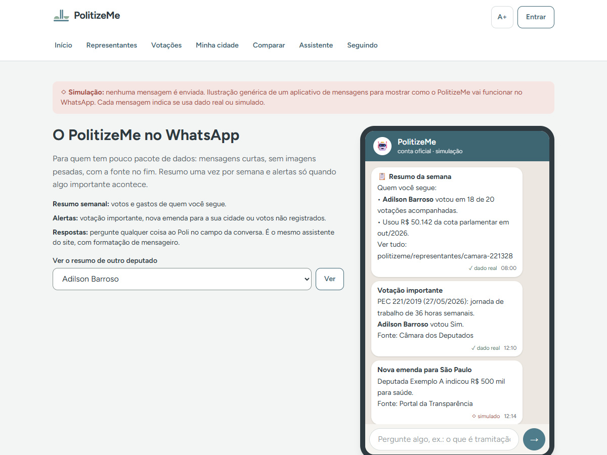

# PolitizeMe

Acompanhe, durante todo o mandato, o que fazem os deputados federais e senadores que representam o estado de São Paulo: como votaram, quanto gastaram da cota parlamentar e o que chegou à sua cidade. Com dados públicos oficiais, em linguagem simples e sem dizer em quem votar.

**Acesse:** https://politizeme.vercel.app · ou rode localmente com Docker (abaixo).

Projeto da **Global Solution 2026.2 da FIAP**, tema **CitizenTech – "O cidadão no centro da inovação"**, turma 2TSCPW.

| Integrante | RM |
| --- | --- |
| Guilherme Moraes de Sousa | 563530 |
| Júlia Ferreira França | 563445 |

| Início | Votação: cada deputado de SP | Assistente Poli |
| --- | --- | --- |
|  |  |  |

| Cota parlamentar no perfil | Simulação do WhatsApp |
| --- | --- |
|  |  |

## O que é real e o que é simulado

O PolitizeMe é um protótipo e diz isso em cada tela: todo bloco de dados tem um selo **✓ Dado real** (com fonte e data de coleta) ou **◇ Dado simulado**. A lista completa está na página [Sobre os dados](https://politizeme.vercel.app/sobre-os-dados) e em [docs/DADOS.md](docs/DADOS.md).

| Real (fonte oficial, coletado em 18/11/2026) | Simulado (ilustrativo, autores fictícios) |
| --- | --- |
| 70 deputados federais e 3 senadores de SP em exercício (Câmara e Senado) | Emendas parlamentares por município (real: Portal da Transparência/CGU) |
| Cota parlamentar 2025–2026: ~47,5 mil despesas, por categoria, mês e fornecedor, com link da nota fiscal | Prestação de contas de campanha (real: TSE) |
| 20 votações nominais de mérito do Plenário, o voto de cada deputado de SP e a orientação dos partidos | Envio de mensagens pelo WhatsApp (a tela é uma simulação) |
| 645 municípios de SP (IBGE) e busca por CEP (ViaCEP) | Envio do e-mail de recuperação de senha |

Dados simulados **nunca** aparecem ligados ao nome de um parlamentar real.

## Funcionalidades

- **Início:** CEP ou município → quem representa você. Sem cadastro. O CEP não é guardado.
- **Representantes e Perfil:** participação nas votações, voto em cada uma, gastos da cota (gráficos por categoria e mês a mês, fornecedores e notas fiscais).
- **Votações explicadas:** ementa oficial, resultado geral e de SP, voto de cada deputado com busca e filtros, orientação dos partidos. Sim e Não têm o mesmo peso visual.
- **Minha cidade:** emendas (simuladas) e gastos reais dos representantes de SP.
- **Comparar:** até três representantes lado a lado, em ordem alfabética, sem ranking.
- **Assistente Poli:** responde com fonte, recusa indicar voto, redireciona assuntos da prefeitura. Tem botão para ouvir a resposta e para perguntar falando.
- **Seguir e alertas:** conta opcional com consentimento LGPD; linha do tempo de votos e gastos de quem você segue.
- **WhatsApp (simulação):** resumo semanal e alertas com dados reais, e conversa com o Poli no formato de mensageiro.
- **Minha conta:** mostra tudo o que é guardado e permite excluir a conta. Recuperação de senha por link de uso único.
- **Painel de uso:** indicadores anônimos para a equipe (perguntas ao Poli por tipo, cidades que mais buscam).
- **Acessibilidade:** botão A+ para aumentar a letra, contraste ≥ 4,5:1, alvos de toque ≥ 44 px, tabela alternativa em todo gráfico.

## Como rodar

### Docker (recomendado para avaliar)

Pré-requisito: [Docker Desktop](https://www.docker.com/products/docker-desktop/) aberto.

```bash
git clone https://github.com/jffdevbr/politizeme.git
cd politizeme
docker compose up --build
# abra http://localhost:3000
```

Sobe o PostgreSQL (com volume persistente) e a aplicação, cria as tabelas e carrega os dados reais do snapshot versionado em `data/snapshot/`. Não precisa de internet depois da primeira build nem de nenhuma chave.

Opcional: crie um `.env` a partir de `.env.example` com `ANTHROPIC_API_KEY` para ativar o modo com IA do Poli. Esse modo é cobrado à parte na API da Anthropic; sem a chave, o Poli funciona por regras e consultas ao banco, sem custo.

### Atualizar os dados oficiais

```bash
python etl/executar_tudo.py                          # só biblioteca padrão do Python 3.10+
docker compose exec app node prisma/seed.mjs --force # recarrega o banco
```

Docker × Vercel, desenvolvimento sem Docker e backup: [docs/DEPLOY.md](docs/DEPLOY.md).

## Arquitetura

```
Fontes oficiais ──► ETL Python ──► data/raw (bruto) ──► data/snapshot (tratado, versionado)
(Câmara, Senado,                                               │ seed
 IBGE, ViaCEP)                                                 ▼
                                   Next.js (site + API + Poli) ◄──► PostgreSQL
                                                │                   (Docker ou Neon)
                                                └──► Claude (opcional, só com dados do banco)
```

Next.js 15 · React 19 · Tailwind 4 · Prisma 6 · PostgreSQL 16 · Recharts · Python 3 (ETL) · Docker Compose · Vercel + Neon. A evolução proposta na Azure (Data Factory, ADLS, Container Apps, AI Search) está em [docs/ARQUITETURA.md](docs/ARQUITETURA.md).

## Documentação

| Documento | Conteúdo |
| --- | --- |
| [Arquitetura](docs/ARQUITETURA.md) | Fluxo dos dados, o que está implementado e a evolução na Azure |
| [Dados](docs/DADOS.md) | Fontes, real × simulado, tratamento, achados da coleta e modelo |
| [Fluxo principal](docs/FLUXO_PRINCIPAL.md) | Fluxo demonstrado no pitch e a votação usada no vídeo (PEC 221/2019) |
| [Poli](docs/POLI.md) | Regras do assistente, modo híbrido e perguntas de teste |
| [LGPD](docs/LGPD.md) | Privacidade, segurança, backup e vieses |
| [Disciplinas](docs/DISCIPLINAS.md) | Onde cada disciplina do ano aparece |
| [Deploy](docs/DEPLOY.md) | Docker × Vercel e como rodar |

## Limitações conhecidas

- Votações do **Senado** ainda não foram coletadas (só senadores e cota).
- "Participação" é calculada sobre as 20 votações selecionadas, não é a presença oficial em sessões.
- A complementação do auxílio-moradia é contada como gasto da cota: é interpretação nossa do arquivo da Câmara (ver [DADOS.md](docs/DADOS.md)).
- Sem envio real de e-mail, WhatsApp ou SMS.
- O logo e o Poli no site são versões simplificadas redesenhadas a partir do Guia Visual.

## Princípios

Neutralidade (sem notas, rankings ou recomendação de voto) · fonte sempre visível · linguagem simples · feito para quem tem menos acesso · privacidade (nunca perguntamos voto ou partido).
