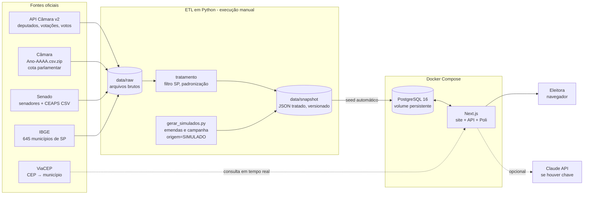
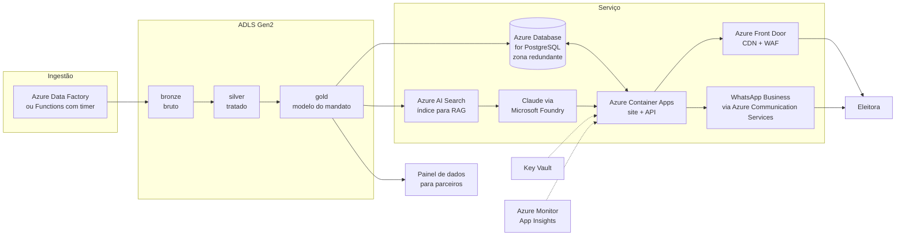

# Arquitetura

Este documento separa com clareza **o que está implementado neste repositório** (MVP) do que é **evolução proposta** (arquitetura em nuvem na Azure). Assim cada parte pode ser defendida com segurança.

## 1. Visão geral do fluxo de dados

Do dado oficial até a tela da eleitora, em cinco etapas:

| Etapa | O que acontece | Disciplina |
| --- | --- | --- |
| 1. Coleta | Leitura das APIs e arquivos oficiais (Câmara, Senado, IBGE, ViaCEP) | Data Protection & Ingestion |
| 2. Armazenamento | Camada bruta (`data/raw`), camada tratada (`data/snapshot`) e banco relacional (PostgreSQL) | Data Warehousing & Integration |
| 3. Tratamento | Filtro de SP, padronização de nomes, categorias e valores, cruzamento parlamentar × votação × despesa | Data Warehousing & Integration |
| 4. Análise e IA | Estatística descritiva dos gastos e da participação; assistente Poli com respostas baseadas só nos dados do banco | ML & AI · AI & Deep Learning |
| 5. Entrega | Site (Next.js) com gráficos, simulação do WhatsApp, painel de uso | BI, Analytics & Data Viz |

Segurança e LGPD atravessam todas as etapas (ver [LGPD.md](LGPD.md)).

## 2. MVP implementado (este repositório)

| Componente | Tecnologia | Função |
| --- | --- | --- |
| ETL | Python 3 (só a biblioteca padrão) | Coleta, filtra SP, padroniza e grava o snapshot tratado |
| Snapshot | Arquivos JSON versionados no Git | Permite subir a aplicação **sem internet** e sem rodar o ETL; fonte do seed |
| Banco | PostgreSQL 16 + Prisma ORM | Modelo do mandato (parlamentares, despesas, votações, votos) e dados dos usuários, em tabelas separadas |
| Aplicação | Next.js 15 (React, TypeScript), Tailwind, Recharts | Páginas, gráficos, API interna, autenticação, assistente |
| Autenticação | bcrypt + cookie de sessão assinado (JWT, `jose`) | Cadastro opcional, só para seguir representantes |
| Assistente Poli | Regras + consultas ao banco; Claude (opcional) | Responde com fonte; recusa indicar voto |
| Contêineres | Docker Compose (`db` + `app`) | Qualquer pessoa sobe tudo com um comando |
| Publicação | Vercel (Hobby) + Neon (Postgres gerenciado) | Link público: https://politizeme.vercel.app; cada push na `main` publica nova versão |
| Backup | `scripts/backup.sh` (`pg_dump`) | Cópia do banco com data no nome |

**Decisões do MVP e por quê**

- **Snapshot versionado no lugar de coleta automática:** os dados públicos mudam devagar e são os mesmos para todos os usuários. Coletar uma vez, tratar e versionar torna a demonstração reprodutível e independente das APIs oficiais estarem no ar.
- **PostgreSQL em vez de SQLite:** o mesmo banco funciona no Docker e em serviço gerenciado (Neon no Vercel, Azure Database for PostgreSQL na evolução). Só muda a variável `DATABASE_URL`.
- **Dados de usuário separados dos dados públicos:** tabelas distintas; a camada pública não contém nenhuma informação de usuário.
- **Selo de origem em todo dado:** cada registro de conteúdo carrega `origem` (`REAL` ou `SIMULADO`), `fonte` e data de coleta, exibidos na interface.

## 3. Evolução proposta: Azure

O que muda quando o PolitizeMe sai do protótipo e passa a acompanhar o mandato de 2027 em produção.

| Necessidade | MVP (hoje) | Evolução (Azure) |
| --- | --- | --- |
| Coleta | Script Python manual | Data Factory / Functions agendadas (diária para votações, mensal para cotas) |
| Armazenamento bruto | `data/raw` local | ADLS Gen2 em camadas bronze → silver → gold |
| Banco | PostgreSQL em contêiner | Azure Database for PostgreSQL, alta disponibilidade entre zonas |
| Aplicação | Contêiner local | **O mesmo contêiner** no Azure Container Apps, com escala automática |
| IA | Regras + Claude opcional com contexto do banco | RAG com Azure AI Search sobre ementas, textos e despesas |
| Canais | Simulação do WhatsApp | WhatsApp Business (Azure Communication Services), SMS |
| Segredos | Arquivo `.env` | Key Vault + identidade gerenciada |
| Backup | `pg_dump` manual | Backup automático com retenção e restauração em outra região |
| Painel de dados | Desenho com dados reais do TSE no PDF da apresentação | Painel para parceiros ligado à camada gold |

**As três perguntas da nuvem**

| Pergunta | Resposta |
| --- | --- |
| Como cresce? | Os dados públicos são processados uma vez e servidos de cache (Front Door). A aplicação escala horizontalmente no Container Apps. Novos estados entram como novas cargas no mesmo pipeline. |
| Como protege os dados? | Dados de usuário em banco separado, criptografado em repouso e em trânsito, acesso por função (Entra ID) e segredos no Key Vault. Os dados públicos não identificam ninguém. |
| Como continua disponível? | Banco com redundância entre zonas, réplicas da aplicação e cache. Se uma API oficial sair do ar, o PolitizeMe continua mostrando a última versão coletada, com a data (o mesmo princípio do snapshot do MVP). |
